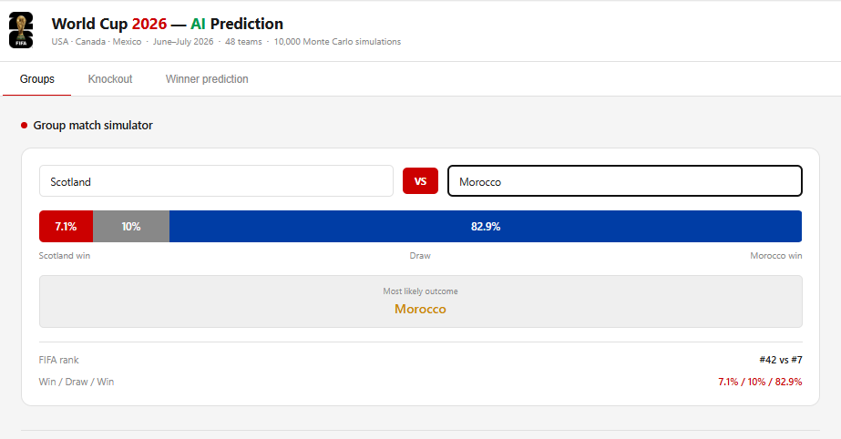

# FIFA World Cup 2026 Prediction and Simulation

Before the start of the FIFA World Cup 2026, I developed this project alongside [PROBI Nouhaila](https://github.com/nouhailaprobi), to explore how machine learning and historical football data could be used to predict match outcomes and simulate possible tournament scenarios.

The project combines football data collection, feature engineering, machine learning, and probabilistic simulation to analyze team performance and explore potential outcomes ahead of the tournament.

## Project Objectives

- Collect and organize football data from historical datasets and API-Football.
- Store and manage match data and engineered features using MongoDB.
- Build team performance indicators from historical match statistics.
- Train machine learning models to predict home wins, draws, and away wins.
- Simulate possible FIFA World Cup 2026 outcomes through repeated probabilistic simulations.
- Evaluate model performance and identify the features that contribute most to predictions.

## Project Structure

```text
world-cup-prediction-platform/
├── data/
│   └── raw/
│       └── historical_1930_2018/  # 26 Kaggle CSV files
├── models/                        # Trained ML models (.pkl) (after execution)
├── reports/                       # Generated HTML dashboard
├── exports/                       # Exported CSV files (after execution)
├── src/
│   ├── data/
│   │   ├── import_to_mongodb.py   # Import CSV data into MongoDB
│   │   ├── fix_players.py         # Player data correction
│   │   ├── fetch_2022.py          # Fetch 2022 data via API
│   │   └── prepare_2022_for_training.py  # Prepare 2022 data for training
│   ├── features/
│   │   └── build_features.py      # Feature engineering
│   ├── models/
│   │   ├── train_model_v3.py      # XGBoost model training
│   │   ├── train_model_v4.py      # Logistic Regression training
│   │   └── validate_2022.py       # Validation on the 2022 World Cup
│   ├── simulation/
│   │   ├── simulate_2026_v3.py    # World Cup 2026 simulation (10,000 runs)
│   │   └── generate_dashboard.py  # Generate the HTML dashboard
│   └── utils/
│       ├── config.py              # Configuration (.env)
│       └── db.py                  # MongoDB connection
├── requirements.txt               # Python dependencies
├── setup_and_run.sh               # Main end-to-end execution script
└── main.py                        # Connection test
```


## Methodology

Our workflow consists of six main stages:

1. **Data Collection:** We use historical football match data and API-Football for data acquisition.
2. **Data Storage:** We use MongoDB to manage match data and team performance features.
3. **Feature Engineering:** We derive indicators such as cumulative appearances, goals scored and conceded, wins, goal difference, and recent form.
4. **Model Training:** We train and evaluate XGBoost and Logistic Regression classifiers.
5. **Match Prediction:** We estimate the probabilities of home wins, draws, and away wins.
6. **Tournament Simulation:** We use predicted probabilities in a simulation pipeline configured for 10,000 runs.

## Machine Learning Models

We trained and evaluated two classification models using a dataset of 900 matches, with 180 matches used for evaluation.

| Model | Version | Accuracy |
|---|---|---:|
| XGBoost | v3 | 60.56% |
| Logistic Regression | v4 | 62.22% |

### Classification Performance

| Outcome | XGBoost F1-score | Logistic Regression F1-score |
|---|---:|---:|
| Away win | 0.47 | 0.41 |
| Draw | 0.17 | 0.05 |
| Home win | 0.74 | 0.77 |

The results show that both models perform better at identifying home wins than draws or away wins. Although Logistic Regression achieves slightly higher overall accuracy, its ability to identify draws remains particularly limited.

### Most Influential Features

The XGBoost model highlights several important indicators related to historical team performance:

- Difference in cumulative appearances
- Difference in cumulative goals scored
- Difference in cumulative wins
- Away-team cumulative goals scored
- Difference in cumulative goal difference
- Home and away teams' historical goal statistics
- Recent goal difference

These features help represent differences in team experience, scoring performance, and historical results.

## FIFA World Cup 2026 Simulation

To explore possible tournament scenarios ahead of the competition, we implemented a simulation pipeline based on predicted match probabilities.

The current simulation configuration includes:

- 10,000 simulation runs
- 2,256 team matchups with precalculated probabilities
- Batch probability computation to improve computational efficiency

The simulation explores potential tournament outcomes using model-generated probabilities. Its results depend on the available data, model performance, and simulation assumptions.

## Results Summary

| Metric | Result |
|---|---:|
| Historical matches in the dataset | 900 |
| Evaluation matches | 180 |
| XGBoost accuracy | 60.56% |
| Logistic Regression accuracy | 62.22% |
| Team feature documents reported in MongoDB | 84 |
| Configured simulation runs | 10,000 |
| Precalculated matchups | 2,256 |

Overall, the models provide a baseline for football match prediction, while the simulation pipeline offers a way to explore potential scenarios for the 2026 tournament. The results also highlight opportunities for improvement, especially in predicting draws and balancing performance across outcome classes.

## Dashboard Preview

The platform provides an interactive dashboard to explore football match predictions and FIFA World Cup 2026 simulation results.




## Technologies Used

- **Python** — data processing and machine learning
- **MongoDB** — data storage and management
- **API-Football** — football data access
- **Pandas** — data manipulation
- **Scikit-learn** — model evaluation and Logistic Regression
- **XGBoost** — gradient-boosted classification
- **Monte Carlo simulation** — exploration of possible tournament outcomes


## Execution

**1. Install Python** (Ubuntu)

```bash
sudo apt update
sudo apt install python3 python3-pip python3-venv
```

**2. Run the setup**

```bash
bash setup_and_run.sh
```

**3. Configure credentials**

During setup, provide:

- **MongoDB Atlas URI:** [Create a MongoDB database](https://www.mongodb.com/fr-fr)
- **API-Football API key:** [Get your API key](https://www.api-football.com/)

The setup installs dependencies, configures the environment, and launches the pipeline.

## Limitations

- Evaluation is based on a dataset of 900 matches and may not represent all international football scenarios.
- Model performance varies across outcome classes.
- Draws remain difficult to predict reliably.
- Simulation results depend on the quality of the data, the predictive models, and the assumptions used.
- The configured number of simulations does not guarantee accurate tournament forecasts.


